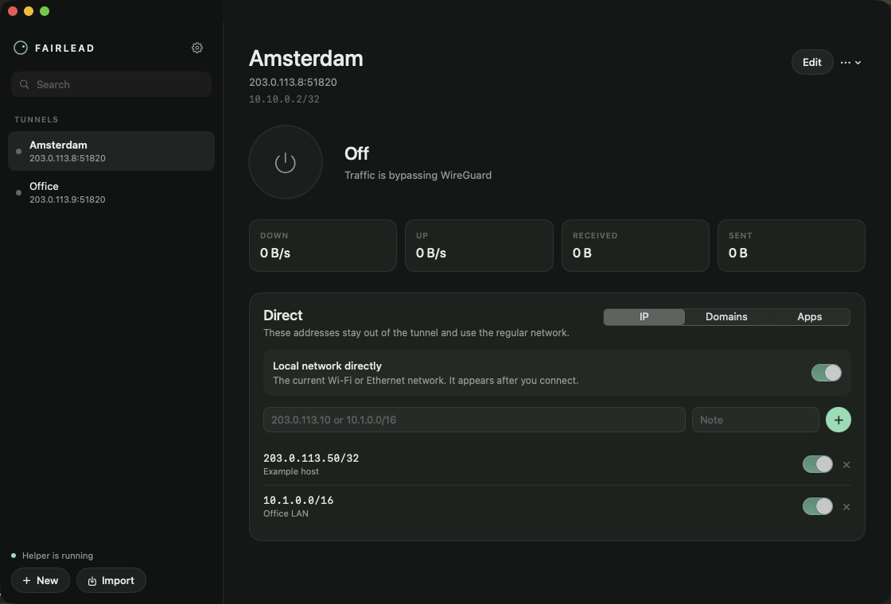
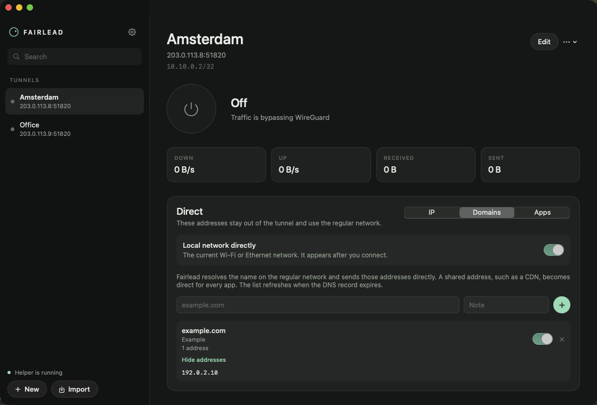
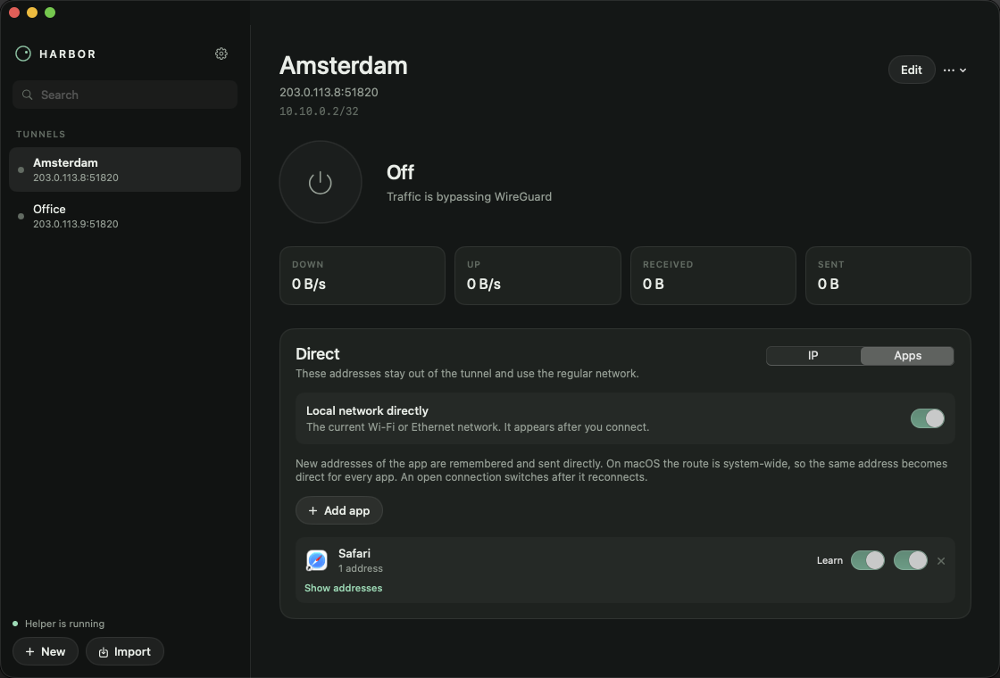
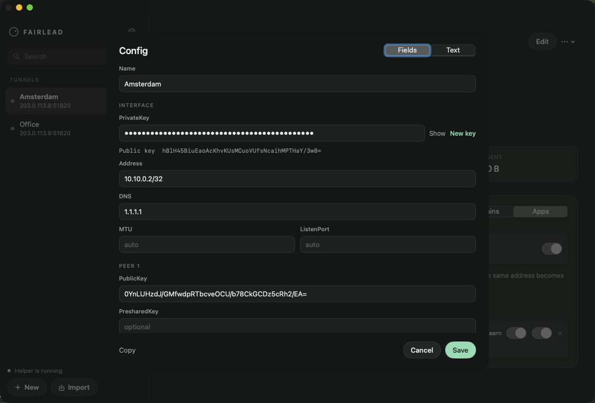
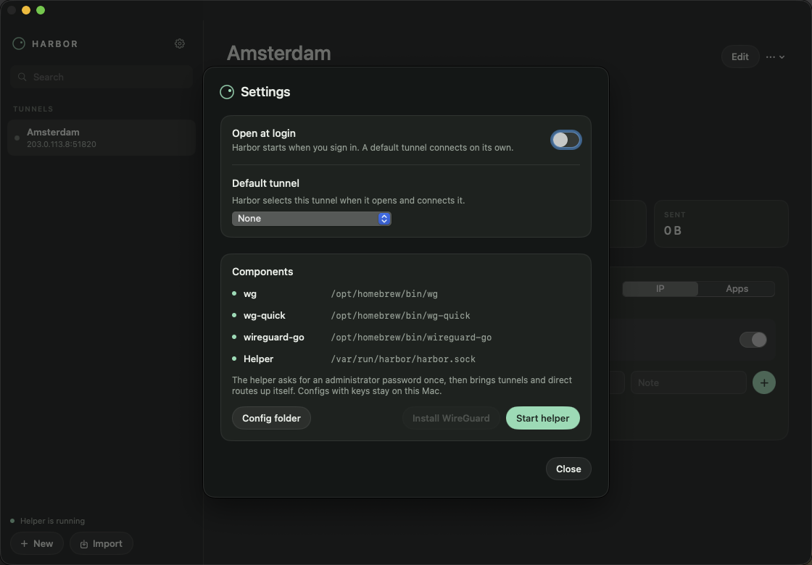

<p align="center">
  
</p>

<h1 align="center">Fairlead</h1>

Fairlead is a macOS app for WireGuard. You import a config, connect, and can keep selected traffic on your normal network.

WireGuard is a trademark of Jason A. Donenfeld. Fairlead is an independent client.

## Install

Copy `Fairlead.app` to `/Applications` and open it.

From a build on the same machine:

```bash
scripts/build-app.sh
ditto dist/Fairlead.app /Applications/Fairlead.app
open /Applications/Fairlead.app
```

`wireguard-go` is shipped inside the app. The first connection asks for an administrator password and installs a helper. After that the helper starts with the system. Configs and keys are stored in `~/Library/Application Support/Fairlead` and are readable only by your user.

Closing the window leaves Fairlead in the menu bar and removes its Dock icon. Open the window again from the menu bar. Quit from the menu bar to disconnect: Fairlead removes the routes it added and restores DNS.

## Gatekeeper

The app is ad-hoc signed and is not notarized. A build made on the same Mac opens without a Gatekeeper prompt. A copy received through a browser, AirDrop, Messages, or Mail is quarantined, and macOS stops the first launch.

Put the app in `/Applications` before opening it. Launching a quarantined app from Downloads or a disk image can run a translocated copy from a temporary read-only directory, and the helper would be installed from there.

Since macOS Sequoia, Control-click → Open does not approve an unnotarized app. Use one of the two ways below.

**System Settings**

1. Double-click Fairlead. If macOS says it cannot check the app for malicious software, click Done. Move to Trash deletes the app.
2. Open System Settings → Privacy & Security and scroll to the bottom. Fairlead is listed there as blocked.
3. Click Open Anyway, then confirm and authenticate.

The approval applies to that copy. Installing a new copy can bring the prompt back.

**Terminal**

Remove quarantine before the first launch:

```bash
xattr -dr com.apple.quarantine /Applications/Fairlead.app
```

This deletes `com.apple.quarantine` from the bundle and its contents. Do it only for an app you trust: the command skips Gatekeeper's first-launch check. If the attribute is already absent, the command reports that and the app can be opened. For a root-owned copy, prefix the same command with `sudo`.

`spctl --assess` still reports the app as rejected, because it is not notarized. After quarantine is removed, the app launches anyway. The system setting for allowed downloads can stay unchanged.

The password dialog you get while connecting is the helper installer. It is separate from Gatekeeper.

## Tunnels

Import a `.conf`, drop the file on the window, or create a tunnel and edit it in the form or as text. One tunnel runs at a time. Connecting another stops the current one.

The window shows the endpoint, address, handshake, and live down and up rates. The menu bar has the same controls.



## Direct

AllowedIPs in the config decide what enters the tunnel. Direct sends the rest out through the normal gateway.

- An IP address or a network, with an optional note. A rule can be switched off without deleting it.
- A domain, such as `example.com`. Fairlead resolves it with the DNS of your normal network and updates the addresses when the record expires. `*.example.com` is not accepted. If the name points at a shared address, such as a CDN, that address is direct for every program.
- The current Wi-Fi or Ethernet network. Those routes are added when you connect.
- An app. Fairlead remembers the addresses that app connects to. A connection that is already open moves to the direct path after it reconnects.

The routes apply to the whole system, so an address learned for one app or one domain is direct everywhere.





## Configs

The editor has the interface and each peer: keys, address, DNS, MTU, listen port, endpoint, allowed IPs, and keepalive. The private key stays hidden until you show it. The same config can be edited as text, copied, or exported as a `.conf`.

PreUp, PostUp, PreDown, PostDown, and SaveConfig are removed before the tunnel starts. Those commands would run as root.



## Settings

Open Settings from the gear, the menu bar, or Command-Comma.

**Open at login.** Fairlead starts when you sign in. If macOS still needs approval, the switch stays on and Settings points to System Settings → General → Login Items.

**Default tunnel.** Fairlead selects this tunnel when it opens and connects it. Together with Open at login, the tunnel comes up after you sign in. None opens Fairlead without connecting.

**Components.** Shows `wireguard-go` and the helper. Start helper installs the helper, or replaces it when the installed copy is older than the app, after the administrator password. Config folder opens the directory with your configs.



## Language

Fairlead uses the system language. English, Russian, German, Spanish, French, Portuguese, and Simplified Chinese are included.

## Build

Install Xcode Command Line Tools, then:

```bash
scripts/build-app.sh
open dist/Fairlead.app
```

The script writes `dist/Fairlead.app` and ad-hoc signs it. `wireguard-go` comes from `Support/wireguard-go`. It is the MIT-licensed userspace implementation from the WireGuard project. The license is `Support/wireguard-go.LICENSE`.
