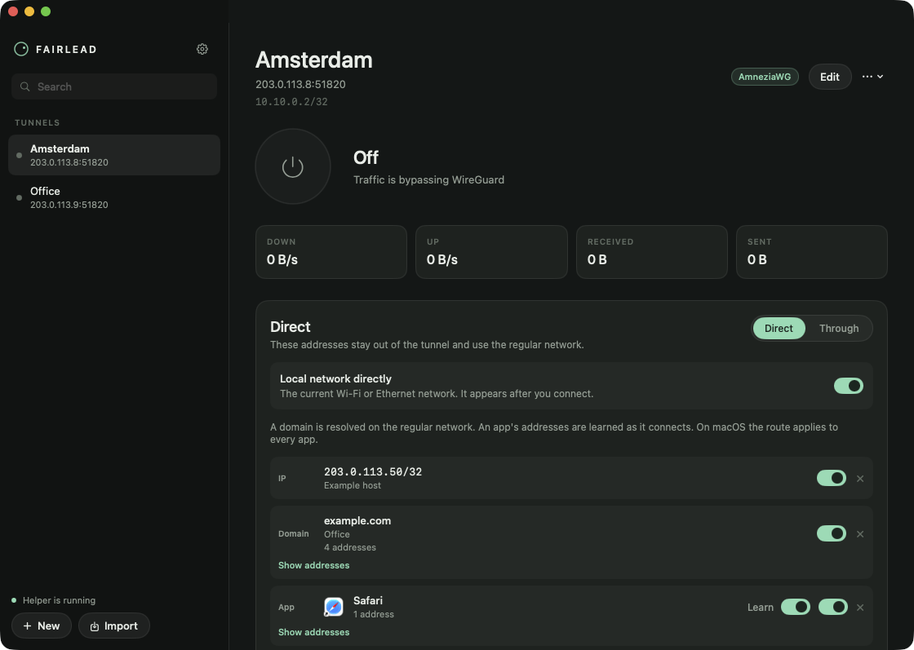
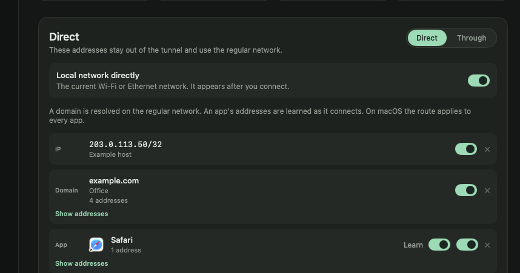
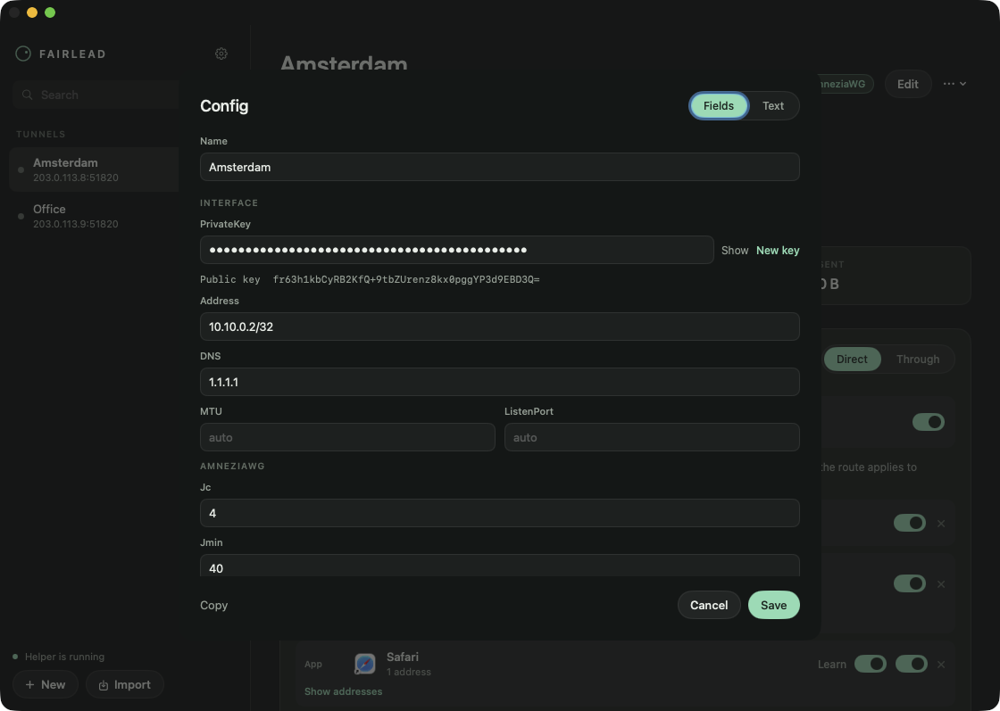
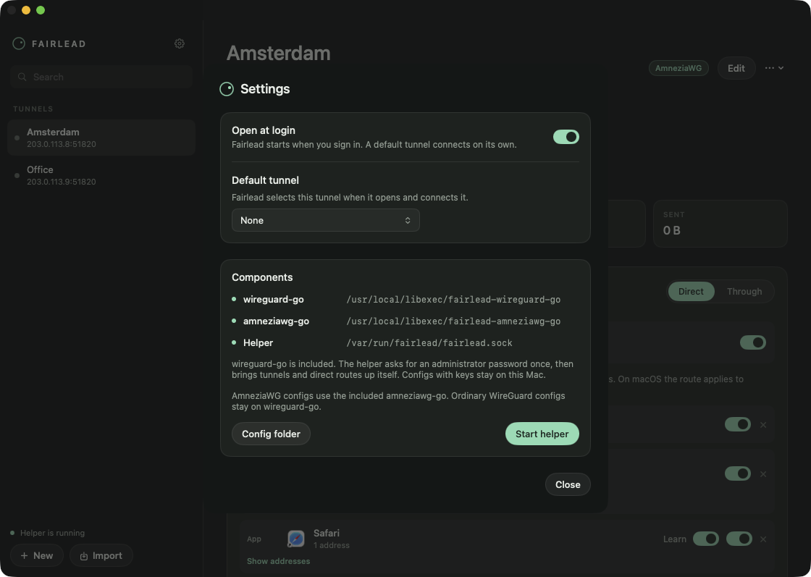

<p align="center">
  
</p>

<h1 align="center">Fairlead</h1>

Fairlead is a macOS app for WireGuard and AmneziaWG. You import a config, connect, and choose which traffic uses the tunnel.

WireGuard is a trademark of Jason A. Donenfeld. Fairlead is an independent client.

## Install

Copy `Fairlead.app` to `/Applications` and open it.

From a build on the same machine:

```bash
scripts/build-app.sh
ditto dist/Fairlead.app /Applications/Fairlead.app
open /Applications/Fairlead.app
```

`wireguard-go` and `amneziawg-go` are shipped inside the app. The first connection asks for an administrator password and installs a helper. After that the helper starts with the system. Configs and keys are stored in `~/Library/Application Support/Fairlead` and are readable only by your user.

Closing the window leaves Fairlead in the menu bar and removes its Dock icon. Open the window again from the menu bar. Quit from the menu bar to disconnect: Fairlead removes the routes it added and restores DNS.

## Gatekeeper

The app is ad-hoc signed and is not notarized. A build made on the same Mac opens without a Gatekeeper prompt. A copy received through a browser, AirDrop, Messages, or Mail is quarantined, and macOS stops the first launch.

Put the app in `/Applications` before opening it. Launching a quarantined app from Downloads or a disk image can run a translocated copy from a temporary read-only directory, and the helper would be installed from there.

Since macOS Sequoia, Control-click → Open does not approve an unnotarized app. Use one of the two ways below.

**System Settings**

1. Double-click Fairlead. If macOS says it cannot check the app for malicious software, click Done. Move to Trash deletes the app.
2. Open System Settings → Privacy & Security and scroll to the bottom. Fairlead is listed there as blocked.
3. Click Open Anyway, then confirm and authenticate.

The approval applies to that copy. Installing a new copy can bring the prompt back.

**Terminal**

Remove quarantine before the first launch:

```bash
xattr -dr com.apple.quarantine /Applications/Fairlead.app
```

This deletes `com.apple.quarantine` from the bundle and its contents. Do it only for an app you trust: the command skips Gatekeeper's first-launch check. If the attribute is already absent, the command reports that and the app can be opened. For a root-owned copy, prefix the same command with `sudo`.

`spctl --assess` still reports the app as rejected, because it is not notarized. After quarantine is removed, the app launches anyway. The system setting for allowed downloads can stay unchanged.

The password dialog you get while connecting is the helper installer. It is separate from Gatekeeper.

## Tunnels

Import a `.conf`, a JSON share, or a text file that contains an Amnezia `vpn://` key. You can also drop the file on the window, or create a tunnel and edit it in the form or as text.

One tunnel runs at a time. Connecting another stops the current one.

An AmneziaWG config is marked in the header. On Windows both protocols run on `amneziawg-go`; a plain config sends no obfuscation fields. The Mac app still runs a plain config on `wireguard-go`.

The window shows the endpoint, address, handshake, and live down and up rates. The menu bar has the same controls.



## Routes

AllowedIPs in the config decide what can enter the tunnel. The switch above the list decides what that list does. Both modes use the same addresses, domains, and apps.

**Direct.** Traffic goes through the tunnel, except the list, which stays on your normal network.

**Through.** Only the list goes through the tunnel. Everything else stays on your normal network.

**Add route** opens a window. Put one address or domain on each line, and a note after it on the same line. **Add app** picks an application. A rule can be switched off without deleting it.

- An IP address or a network, with an optional note.
- A domain, such as `example.com`. Fairlead resolves it with the DNS of your normal network and updates the addresses when the record expires. `*.example.com` is not accepted. If the name points at a shared address, such as a CDN, that address follows the rule for every program.
- The current Wi-Fi or Ethernet network. It stays on your normal connection. Those routes appear after you connect.
- An app. Fairlead remembers the addresses that app connects to. A connection that is already open moves after it reconnects. On macOS a route applies to every program, not only the app that was learned.



## Configs

The editor has the interface and each peer: keys, address, DNS, MTU, listen port, endpoint, allowed IPs, and keepalive. AmneziaWG parameters from the config are edited in the same form. The private key stays hidden until you show it. The same config can be edited as text, copied, or exported as a `.conf`. The Text tab also accepts an Amnezia `vpn://` key.

PreUp, PostUp, PreDown, PostDown, and SaveConfig are removed before the tunnel starts. Those commands would run as root.



## Settings

Open Settings from the gear, the menu bar, or Command-Comma.

**Open at login.** Fairlead starts when you sign in. If macOS still needs approval, the switch stays on and Settings points to System Settings → General → Login Items.

**Default tunnel.** Fairlead selects this tunnel when it opens and connects it. Together with Open at login, the tunnel comes up after you sign in. None opens Fairlead without connecting.

**Components.** Shows `wireguard-go`, `amneziawg-go`, and the helper. Start helper installs the helper, or replaces the one already installed, after the administrator password. Config folder opens the directory with your configs.



## Language

Fairlead uses the system language. English, Russian, German, Spanish, French, Portuguese, and Simplified Chinese are included.

## Build

Install Xcode Command Line Tools, then:

```bash
scripts/build-app.sh
open dist/Fairlead.app
```

The script writes `dist/Fairlead.app` and ad-hoc signs it.

`wireguard-go` comes from `platform/mac/Support/wireguard-go`. It is the MIT-licensed userspace implementation from the WireGuard project. The license is `platform/mac/Support/wireguard-go.LICENSE`.

`amneziawg-go` comes from `platform/mac/Support/amneziawg-go`. It is the userspace AmneziaWG daemon, also MIT-licensed. The license is `platform/mac/Support/amneziawg-go.LICENSE`. `scripts/build-amneziawg-go.sh` rebuilds that binary.

## Layout

`core/` is the shared C kernel: configs, keys, route planning, DNS, UAPI, and Amnezia shares. `platform/mac/` is the SwiftUI app, the helper, resources, and the Swift copy of that kernel the Mac app still runs. `platform/win/` is the WinUI window and the elevated helper. Windows calls `core/` through `fairlead-core.dll`. The Mac app does not link `core/` yet.

## Windows

The window is the WinUI 3 app in `platform/win/ui`. Routes, DNS, and the Wintun adapter stay in `fairlead-helper.exe`. `tests/core_check.c` covers the same cases as `tests/mac`.

Build with MSYS2 MinGW gcc and the .NET 10 SDK:

```bat
scripts\build-win.bat
dist\win\Fairlead.exe
```

`dist\win\Fairlead.exe` starts the app. `fairlead-helper.exe`, `amneziawg-go.exe`, and `wintun.dll` sit next to it. Plain WireGuard and AmneziaWG both run on `amneziawg-go`. A plain config sends no obfuscation fields. The window and the .NET and WinUI runtime live in `dist\win\bin`, because that runtime is loaded from the folder of the process itself. Compiler output and the core test binary stay in `.build\win`.

`scripts\build-win-userspace.ps1` downloads a Windows Go toolchain and builds `amneziawg-go.exe` and `wintun.dll` into `.build\win`. The app build copies them next to `dist\win\Fairlead.exe`. The tunnel runs that userspace daemon. The Mac app still ships `wireguard-go` beside it. The first time Fairlead starts the helper, Windows asks for administrator rights and Fairlead saves a scheduled task named `FairleadHelper`. Later launches, including after a reboot, start that task and do not ask again. The helper creates the Wintun adapter, applies routes, and sets DNS. Starting Fairlead again shows the window that is already open. The published app carries its own .NET and WinUI runtime, so a user does not install either. Configs stay in `%AppData%\Fairlead`. Closing the window hides it and leaves the tray icon. Quit Fairlead, in that menu, disconnects and exits.
