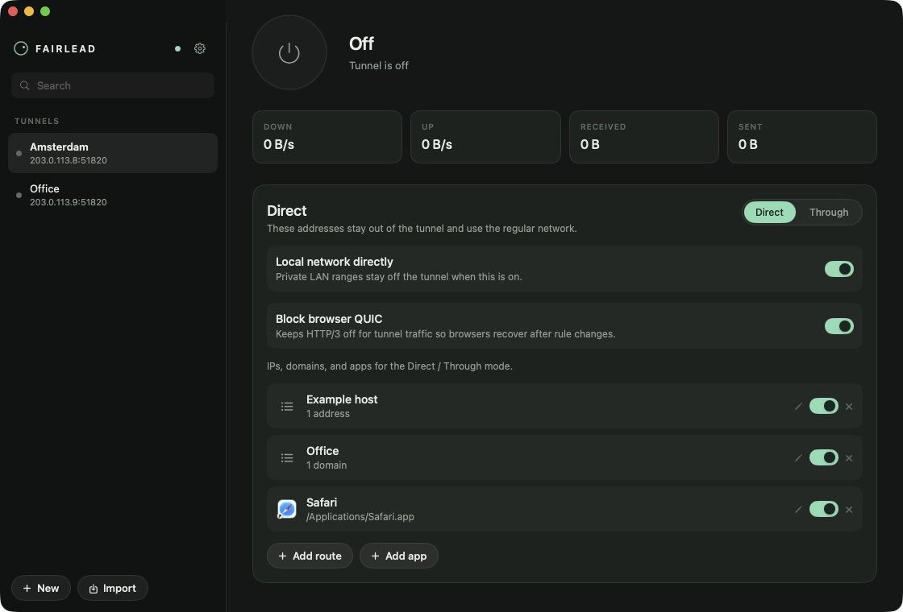
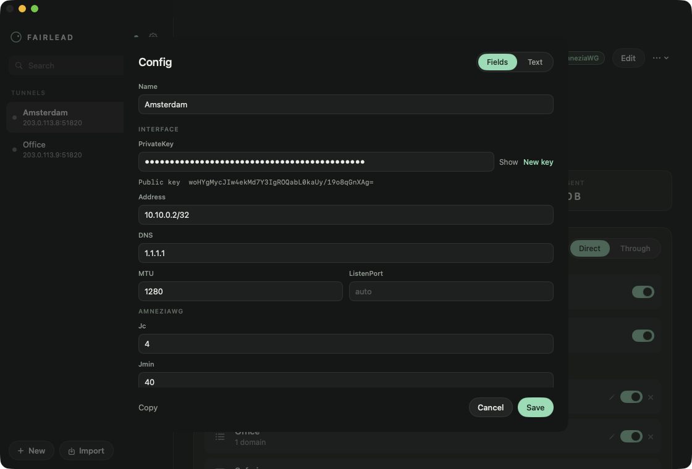
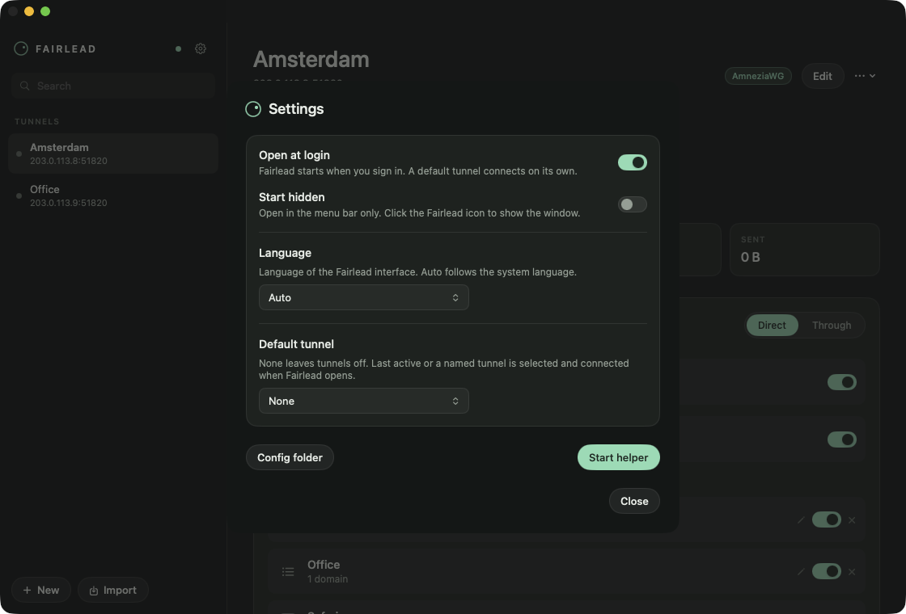

<p align="center">
  
</p>

<h1 align="center">Fairlead</h1>

Fairlead is a WireGuard and AmneziaWG client for macOS and Windows. You import a config, connect, and choose which traffic uses the tunnel.

The data plane is [mihomo](https://github.com/MetaCubeX/mihomo) (Clash Meta): TUN, DNS, process rules, WireGuard, and AmneziaWG. Fairlead is the UI, the config editor, and a small privileged helper that starts and stops mihomo.

WireGuard is a trademark of Jason A. Donenfeld. Fairlead is an independent client.

## Install

Download the archive for your system from the [releases](https://github.com/razor-4eg/fairlead/releases) page and unzip it.

On a Mac, move `Fairlead.app` to `/Applications` and open it from there.

On Windows, run `Fairlead.exe`. Keep the unzipped folder as it is. Fairlead does not have its own installer, and the files next to `Fairlead.exe` have to stay there.

The first time you connect, the system asks for an administrator password. Fairlead uses it to install a helper. Later connections do not ask. The helper also comes back after you restart the computer.

Configs stay on this computer, readable only by your account. On a Mac they are in `~/Library/Application Support/Fairlead`. On Windows they are in `%AppData%\Fairlead`. Settings has a button that opens this folder.

## If macOS blocks the app

A Fairlead you downloaded is not notarized, so macOS stops the first launch. A copy built on the same Mac opens without this prompt.

1. Double-click Fairlead. If macOS says it cannot check the app for malicious software, click Done. Move to Trash deletes the app.
2. Open System Settings → Privacy & Security and scroll to the bottom. Fairlead is listed there as blocked.
3. Click Open Anyway, then confirm.

The approval is for that copy. A new copy can ask again.

You can also remove the block in Terminal before the first launch:

```bash
xattr -dr com.apple.quarantine /Applications/Fairlead.app
```

Do this only for an app you trust. The password you see while connecting is the helper installer. It is a separate prompt.

## Opening and quitting

Closing the window does not disconnect. Fairlead keeps running: in the menu bar on a Mac, and in the tray on Windows. On a Mac the Dock icon goes away while the window is closed. Open the window again from that icon.

Quit from the same menu when you want to disconnect. Fairlead stops mihomo and restores normal routing and DNS.

One tunnel runs at a time. Connecting another stops the current one.

## Tunnels

Import a `.conf`, a JSON share, or a text file that contains an Amnezia `vpn://` key. You can drop the file on the window, or create a tunnel and edit it in the form or as text.

An AmneziaWG config is marked in the header. A plain WireGuard config connects as WireGuard.

The window shows the endpoint, address, handshake, and live down and up rates. The menu bar on a Mac, and the tray menu on Windows, have the same controls.


## Routes

AllowedIPs in the config decide what the WireGuard peer can carry. The switch above the list decides how Fairlead’s filter list is applied. Both modes use the same addresses, domains, and apps. Fairlead writes the list into the mihomo config as rules, and mihomo does the routing.

**Direct.** Traffic goes through the tunnel, except the list, which stays on your normal network.

**Through.** Only the list goes through the tunnel. Everything else stays on your normal network.

**Add route** opens a window. Give the list a name and put one address or domain on each line. **Add app** picks an application. A rule can be switched off without deleting it.

- An IP address or a network. Mihomo matches it as a CIDR.
- A domain, such as `example.com`. Mihomo matches the name itself, so Fairlead does not look up addresses ahead of time. `*.example.com` is not accepted.
- The current Wi-Fi or Ethernet network. It stays on your normal connection.
- An app. Mihomo matches the process path of the running program, not addresses it connected to before. On a Mac, a `.app` bundle includes helper processes inside the bundle.



## Configs

The editor has the interface and each peer: keys, address, DNS, MTU, listen port, endpoint, allowed IPs, and keepalive. AmneziaWG parameters from the config are edited in the same form. The private key stays hidden until you show it. The same config can be edited as text, copied, or exported as a `.conf`. The Text tab also accepts an Amnezia `vpn://` key.

PreUp, PostUp, PreDown, PostDown, and SaveConfig are not run.



## Settings

Open Settings from the gear. On a Mac you can also use the menu bar or Command-Comma.

**Open at login.** Fairlead starts when you sign in. On a Mac, if the system still needs approval, the switch stays on and Settings points to System Settings → General → Login Items.

**Default tunnel.** Fairlead selects this tunnel when it opens and connects it. Together with Open at login, the tunnel comes up after you sign in. None opens Fairlead without connecting.

**Components.** Shows mihomo and the helper. Start helper installs the helper, or replaces the one already installed, after the administrator password. Config folder opens the directory with your configs.



## Language

Fairlead uses the system language. English, Russian, German, Spanish, French, Portuguese, and Simplified Chinese are included.
