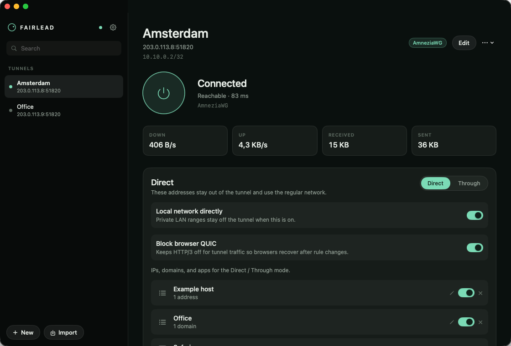

<p align="center">
  
</p>

<h1 align="center">Fairlead</h1>

<p align="center">
  <strong>WireGuard and AmneziaWG for macOS and Windows</strong><br>
  Import a config, connect, and choose what goes through the tunnel.
</p>

<p align="center">
  <a href="https://github.com/razor-4eg/fairlead/releases"></a>
  <a href="https://github.com/razor-4eg/fairlead/releases"></a>
  
  
</p>

Fairlead is a desktop client for [WireGuard](https://www.wireguard.com/) and AmneziaWG. You keep your configs on this computer, connect when you need to, and decide which addresses, domains, and apps use the tunnel — or stay on the regular network.

WireGuard is a trademark of Jason A. Donenfeld. Fairlead is an independent client.



---

## Features

- **WireGuard and AmneziaWG** in one app — Amnezia configs show an AmneziaWG badge
- **Import** `.conf` files, JSON shares, or Amnezia `vpn://` links; drag and drop onto the window
- **Direct / Through** routing — either exclude a list from the tunnel, or send only that list through it
- **Live filter updates** — Direct / Through rules apply while connected (engine restarts cleanly so routes stay honest)
- **Routes by IP, domain, or app** — match running programs by path, not by addresses learned earlier
- **Local network** can stay off the tunnel
- **Optional QUIC block** — rejects UDP/443 so browsers use TCP through the tunnel (needed for YouTube/Chrome)
- **Honest status** — Connected only when the system path actually uses the tunnel, not just an internal probe
- **Live metrics** — rates, totals, and reachability while connected
- **Menu bar (macOS) / tray (Windows)** — close the window without disconnecting
- **Open at login**, start hidden, and a **default tunnel** that can connect on launch
- **Languages:** Auto (system), English, Russian, German, Spanish, French, Portuguese, Simplified Chinese

---

## Install

Download the build for your system from [Releases](https://github.com/razor-4eg/fairlead/releases) and unzip it.

### macOS

1. Move `Fairlead.app` to `/Applications`.
2. Open it from Applications (not from the archive).
3. The first time you connect, macOS asks for an administrator password to install the helper. Later connections do not ask again. The helper also returns after a reboot.

Configs live in `~/Library/Application Support/Fairlead` and are readable only by your account. Settings has a button that opens this folder.

### Windows

1. Unzip the archive and keep the folder as it is — files next to `Fairlead.exe` must stay together. Fairlead has no separate installer.
2. Run `Fairlead.exe`.
3. The first connection asks for administrator rights to install the helper. After that, connect and disconnect without elevating again. The helper comes back after a reboot.

Configs live in `%AppData%\Fairlead`. Settings can open that folder for you.

---

## First launch warnings

Builds from GitHub are not notarized (macOS) and are not signed with an EV certificate (Windows). The system may warn once. That is expected for a download you trust.

### macOS Gatekeeper

1. Open Fairlead. If macOS says it cannot check the app for malicious software, click **Done** (do not move it to Trash).
2. Open **System Settings → Privacy & Security**, scroll to the bottom, and click **Open Anyway**.
3. Confirm when asked.

A new copy of the app can ask again. You can also clear quarantine before the first open (only for a build you trust):

```bash
xattr -dr com.apple.quarantine /Applications/Fairlead.app
```

The administrator password when connecting is for the helper, not for Gatekeeper.

### Windows SmartScreen

1. If SmartScreen says Windows protected your PC, click **More info**.
2. Click **Run anyway**.

Keep the unzipped folder intact so `Fairlead.exe`, the helper, and the bundled engine stay side by side.

---

## Using Fairlead

Closing the window does not disconnect. Fairlead stays in the menu bar on macOS and in the tray on Windows. Quit from that menu when you want the tunnel down and normal routing restored.

Only one tunnel runs at a time. Connecting another stops the current one.

### Tunnels

Import a config, or create one and edit it as fields or as text. The detail view shows the endpoint, address, handshake, and live traffic.


### Routes

Allowed IPs in the WireGuard config still define what the peer can carry. The **Direct / Through** control decides how Fairlead’s filter list is applied:

| Mode | Behavior |
|------|----------|
| **Direct** | Traffic uses the tunnel, except the list, which stays on your normal network |
| **Through** | Only the list uses the tunnel; everything else stays on your normal network |

Add IPs or domains with **Add route**, or pick programs with **Add app**. Each rule can be turned off without deleting it. Domains are matched by name; apps are matched by the running process.


### Settings

- **Open at login** — start Fairlead when you sign in  
- **Start hidden** — menu bar / tray only until you open the window  
- **Language** — Auto follows the system; or pick a fixed language  
- **Default tunnel** — None leaves tunnels off; Last active or a named tunnel is selected and connected when Fairlead opens  
- **Start helper** — install or replace the system helper  
- **Config folder** — open your local configs  


---

## Build from source

### macOS

Requires macOS 15+, Swift 6 tooling, and a mihomo binary in `platform/mac/Support/mihomo` (see `scripts/build-mihomo.sh`).

```bash
./scripts/build-app.sh
```

The app is written to `dist/Fairlead.app`.

### Windows

Requires a MinGW `gcc` on `PATH` (for example MSYS2), Visual Studio with C++ workload / MSBuild, and bundled `mihomo.exe` / `wintun.dll` under `dist\win\bin` (or as described in the build scripts).

```bat
scripts\build-win.bat
```

Output lands in `dist\win`.

---

## Privacy

Configs and keys stay on this computer. Fairlead does not upload them. The helper runs with elevated rights only to manage the tunnel; your settings and tunnel list remain in your user profile.

---

## License and trademarks

See the repository for license terms. WireGuard is a trademark of Jason A. Donenfeld. AmneziaWG is part of the Amnezia project. Fairlead is not affiliated with either.
